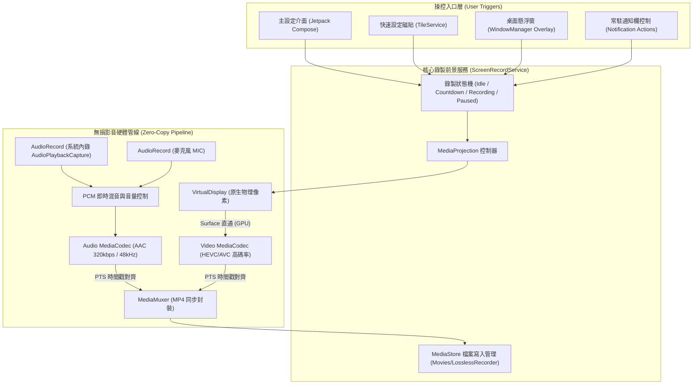

# Android 視覺無損螢幕錄製 App 開發規劃書

## 1. 專案目標與核心痛點解決
針對市面與原廠內建錄影（如 Samsung 內建錄影鎖定 1080p、低碼率導致畫質模糊）的限制，打造一款**點對點原生物理像素（Native Physical Resolution）**、**極高碼率視覺無損**、且具備**高自由度音源與控制方式**的專業級 Android 螢幕錄製工具。

---

## 2. 核心技術突破與設計重點

### 2.1 突破 1080p 限制：取得「真・物理原生解析度」與能力探測
許多手機（如三星 S 系列 Ultra）出廠預設渲染解析度可能設為 FHD+，或原廠錄影強制降採樣至 1080p。本專案將實作：
* **物理像素抓取**：透過 `Display.Mode` (`display.supportedModes`) 與 `WindowMetrics` 取得面板真實物理像素（例如 `3088 × 1440` 或 `3120 × 1440`），同時提供「當前渲染解析度」與「面板最高物理固定解析度」選項。
* **硬體編碼器極限探測 (`MediaCodecList`)**：
  * 自動查詢裝置 SoC（Snapdragon / Dimensity / Exynos）的 `VideoCapabilities`。
  * **動態對齊 (Alignment)**：硬體編碼器通常要求長寬為 2、8 或 16 的倍數（`widthAlignment` / `heightAlignment`），系統會自動計算最接近原生解析度的合規尺寸，避免因非標準比例導致 `MediaCodec.configure()` 崩潰。
  * **高刷支援**：自動偵測螢幕最高更新率（60 / 90 / 120 Hz），並透過 `areSizeAndRateSupported()` 驗證高解析度下的最高可用幀率。

### 2.2 視覺無損編碼管線 (`Surface` Zero-Copy 直通)
* **零拷貝渲染**：採用 `MediaCodec.createInputSurface()` 直接接收 `MediaProjection` 創建的 `VirtualDisplay` 畫面，全程在 GPU / 硬體編碼器記憶體內完成，不經過 CPU 轉換，確保 2K/120fps 不掉幀。
* **視覺無損參數配置**：
  * **編碼器**：優先選用 **H.265 (HEVC)**（相同碼率下畫質遠超 H.264，且對 2K/4K 尺寸支援度更高），並提供 **H.264 (AVC)** 作為相容備選。
  * **碼率控制模式**：支援 `BITRATE_MODE_CBR`（固定高碼率）與 `BITRATE_MODE_CQ` / `VBR`（品質優先），允許用戶拉高至硬體上限（如 **50 Mbps ~ 150 Mbps+**）。
  * **關鍵影格間隔 (`KEY_I_FRAME_INTERVAL`)**：支援設為 `1秒` 甚至 `0`（All-I 全關鍵影格模式，完全消除幀間運動模糊與色塊，極致清晰且適合後期剪輯）。
  * **色彩空間**：支援標準 SDR (BT.709) 及探測 10-bit (HEVC Main10) 支援度。

### 2.3 靈活音訊引擎（系統內錄 + 麥克風自由組合）
用戶可在錄製前選擇 **4 種音源模式**：
1. **靜音模式**（僅錄製純畫面，無音軌）
2. **僅系統內部聲音**（透過 Android 10+ `AudioPlaybackCaptureConfiguration` 擷取遊戲/影片原聲）
3. **僅麥克風聲音**（擷取外部解說）
4. **系統內錄 + 麥克風同時錄製**：
   * 內建即時軟體混音器（Audio Mixer Thread），將兩路 `AudioRecord` 的 16-bit PCM 音訊流對齊時間戳並進行防爆音疊加（可獨立調節內錄與麥克風音量比例），或封裝為雙音軌。
   * **音訊編碼**：採用高規格 AAC-LC（最高 320 kbps / 48kHz 立體聲）或 ALAC/PCM（視封裝相容性）。

> [!NOTE]
> Android 系統安全限制：部分 App（如受 DRM 保護的串流軟體或未開啟 `allowAudioPlaybackCapture` 的舊應用）會禁止系統擷取內部聲音，屆時系統本身會回傳靜音，我們會在 UI 上提供友善提示。

### 2.4 三大操控入口（由用戶自由開關與組合）
為避免錄影開始/結束時錄到 App 自身介面，提供三種完整控制管道：
1. **通知欄控制器 (Notification Controller)**：常駐前台服務通知，提供「開始 / 暫停 / 停止」按鈕，點擊後自動收起通知欄並延遲 300ms 開錄。
2. **桌面懸浮球 (Floating Overlay Widget)**：
   * 支援拖曳靠邊隱藏、倒數計時（3/5秒）、錄影中自動變為半透明小紅點或完全隱藏（可設定搖晃手機或點通知欄停止）。
   * *進階細節*：在 Android 12+ 盡可能避免懸浮球本身被錄入畫面，或於按下錄影瞬間自動隱藏。
3. **快速設定磁貼 (Quick Settings Tile - `TileService`)**：
   * 直接整合至系統下拉控制中心（與系統內建錄影同級體驗），一鍵喚醒授權並啟動無損錄影。

---

## 3. 系統架構圖

---

## 4. 技術棧選型 (Tech Stack)
* **開發語言**：Kotlin (Coroutines + Flow 處理非同步編碼流與狀態同步)
* **UI 框架**：Jetpack Compose + Material 3（支援深色模式、直覺的碼率/解析度滑桿與即時預估檔案大小提示）
* **最低與目標系統**：`minSdk = 29` (Android 10，原生支援系統內錄 `AudioPlaybackCapture` 與 `MediaStore` 分區儲存)，`targetSdk = 34` (Android 14，完整相容最新 `FOREGROUND_SERVICE_MEDIA_PROJECTION` 權限規範)
* **持久化儲存**：Jetpack DataStore（儲存用戶偏好的解析度、碼率、音源組合與控制方式）

---

## 5. 分階段開發計畫 (Implementation Phases)

### 第一階段：專案骨架與硬體能力探測器 (Phase 1)
1. 建立標準 Android Kotlin + Compose 專案結構（配置 Gradle 與 Android 14 前景服務權限）。
2. 實作 `DeviceCapabilityDetector`：
   * 讀取螢幕真實物理像素、DPI 與最高更新率。
   * 掃描硬體 `MediaCodec` (HEVC / AVC) 支援的最大解析度、對齊倍數、最大碼率上限（Bitrate Range）與幀率。

### 第二階段：無損影音編碼核心引擎 (Phase 2)
1. 實作 `VideoEncoderCore`：基於 `Surface` 的硬體編碼器，支援自訂原生解析度、自訂碼率（如 50~150 Mbps）、幀率（60/90/120 fps）與 I-Frame 間隔設定。
2. 實作 `AudioCaptureEngine`：支援單獨系統內錄、單獨麥克風、或雙音源 16-bit PCM 即時混音並送入 `AudioEncoder`。
3. 實作 `MediaMuxerWrapper`：精確處理音畫同步（PTS 時間戳校正）與暫停/繼續時的時間偏移扣除，並直接輸出至系統相簿 (`Movies/LosslessRecorder`)。

### 第三階段：前景服務與三大操控入口 (Phase 3)
1. 實作 `ScreenRecordService`：管理 `MediaProjection` 生命週期與權限請求跳板 Activity（讓磁貼與懸浮窗也能無縫彈出授權）。
2. 實作 **通知欄控制器**、**快速設定磁貼 (`QuickRecordTileService`)** 與 **可拖曳懸浮球 (`FloatingControlManager`)**。

### 第四階段：設定與管理 UI 介面 (Phase 4)
1. **畫質設定面板**：提供「原生物理像素（點對點）」、「自訂解析度」、「編碼格式 (HEVC/AVC)」、「碼率滑桿（附每分鐘預估容量計算）」、「幀率選擇」與「全關鍵影格 (All-I) 開關」。
2. **音源與控制中心面板**：一鍵切換內部聲音/麥克風開關、各別音量增益滑桿，以及三大控制方式（通知欄 / 懸浮球 / 磁貼）的開關與懸浮球自動隱藏設定。
3. **錄影作品列表**：內建簡易預覽列表，直接檢視剛錄好的影片實際解析度、幀率、碼率與檔案大小，驗證無損效果。

---

## 6. 確認與下一步
如果您對這份架構與功能規劃滿意，您可以點擊 **Proceed**（或告訴我需要微調的地方），我將在工作區為您建立完整的 Android 專案並開始實作程式碼！